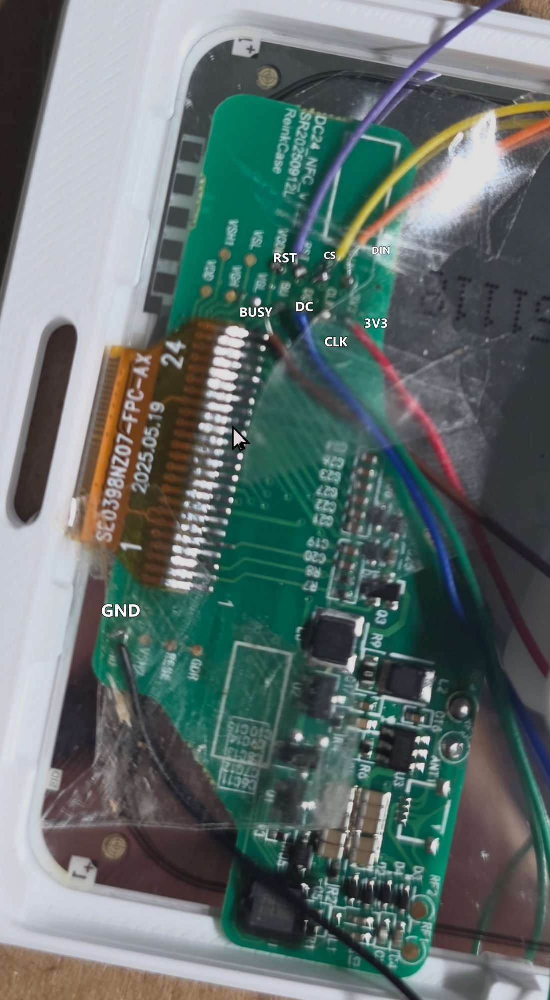
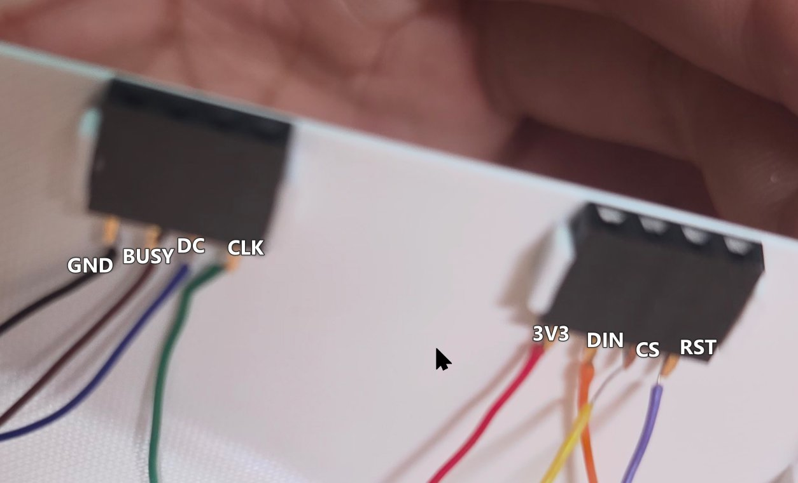

# Huawei 3.7" Color E-Ink Desktop Frame & iPod-Style Dock

基于华为彩显墨水屏（ReinkCase `DC24_NFC_V1.2E`，屏幕尺寸 `63.6 × 91.0 mm`）自制的超薄免胶卡扣桌面摆件外壳 + Apple iPod 风格 15° 倾斜桌面底座（内置 `ESP32-C3 Mini Pro`）。

- **主参数化源码**：[huawei_eink.scad](huawei_eink.scad)
- **渲染配置**：[render.json](render.json)

---

## 1. 结构特点与参数化选项

- **超薄外壳（总厚 `6.4 mm`）**：
  - `case_front` + `case_back` 采用 **6 处隐藏式 PETG 45° 弹性卡扣**，无需胶水即可扣合且可无损拆装。
  - 针对 PCB 右侧突出 `1.5 mm` 与顶部 FPC 排线折角做了内腔局部避让，外观保持平直对称。
  - 底部采用**不对称 2×4pin 2.54mm 直插母座**（`10.7 × 2.4 × 8.4 mm`，横向中心位于正面视角 `X = -17.0 mm` 与 `X = +11.0 mm`），物理防反插。
- **参数化开关**（在 `huawei_eink.scad` 顶部修改）：
  - `enable_lanyard_hole = true`（默认 **ON**）：顶部增加 `5.8 mm` 边框与 `15.2 × 3.2 mm` 工牌挂绳槽。
  - `enable_acrylic = false`（默认 **OFF**）：开启后自动增加 `0.35 mm` 内腔深度（容纳 `0.3 mm` 亚克力保护片）并同步放宽底座插槽。
- **iPod 风格低矮倾斜底座（高 `17.2 mm`，15° 后仰）**：
  - 插入后墨水屏有效显示区域 **100% 完整露出**。
  - 内部适配 **`25.5 × 18.0 mm` ESP32-C3 Mini Pro**，后置 `11.4 × 5.0 mm` 精致封闭式 Type-C 小窗口。
  - `dock_body` 倒置薄壳掏空设计（省料近 58%），`dock_bottom` 4 处卡扣免胶扣合，前方预留 2 个 `Ø20.8 mm` 硬币/垫片配重槽。

---

## 2. 切片与打印建议

推荐耗材：**PETG**（0.4 mm 喷嘴 / 0.20 mm 层高 / 3 圈壁厚 / 15~20% 填充）。所有 STL 均已按推荐打印姿态贴床（`Z = 0`）：

| 零件 | 文件 | 推荐打印姿态 | 支撑 |
| :--- | :--- | :--- | :--- |
| 墨水屏前框 | `stl/case_front.stl` | 正面朝下平放 | 无需支撑 |
| 墨水屏后盖 | `stl/case_back.stl` | 背面朝下平放 | 无需支撑 |
| 底座主体 | `stl/dock_body.stl` | **已自动倒置（顶面朝下）** | 仅在中间 `7.1 mm` 倾斜槽底加少量支撑 |
| 底座底盖 | `stl/dock_bottom.stl` | 底面朝下平放 | 无需支撑 |

---

## 3. 飞线参考图（OK 线 0.5 mm）

### PCB 焊盘定义（`ReinkCase DC24_NFC_V1.2E`）



### 背盖内侧 2×4pin 母座焊接顺序



---

## 4. 2×4pin 接口线序（Pinout）

> **防反插识别特征**：两组 4pin 呈不对称分布——**靠近边缘的那一组**（距边 `12.8 mm`）是 **`RST / CS / DIN / 3V3`**；**靠近中线的那一组**（距边 `18.8 mm`）是 **`CLK / DC / BUSY / GND`**。

### ① 正面看（直视墨水屏正面 / 底座正前方看，屏幕竖直正放，左 → 右）

```text
         [ 墨水屏正面 / 底座正前方 ]
  左边缘 ◄──────────────────────────► 右边缘
  ┌────────────────┐      ┌────────────────┐
  │ RST CS DIN 3V3 │      │ CLK DC BUSY GND│
  └────────────────┘      └────────────────┘
   (靠左边缘 X=-17)         (靠中线 X=+11)
```

| 分组（正面看） | 位置（左 → 右） | 信号 | OK 线颜色 |
| :--- | :---: | :---: | :---: |
| **左侧 4pin（靠左边缘）** | 1 | `RST` | 紫 |
| | 2 | `CS` | 黄 |
| | 3 | `DIN` | 橙 |
| | 4 | `3V3` | 红 |
| **右侧 4pin（靠中线）** | 5 | `CLK` | 绿 |
| | 6 | `DC` | 蓝 |
| | 7 | `BUSY` | 棕 |
| | 8 | `GND` | 黑 |

---

### ② 反面看（直视墨水屏背面 / 底座 Type-C 背面看，屏幕竖直正放，左 → 右）

```text
         [ 墨水屏背面 / 底座 Type-C 背面 ]
  左边缘 ◄──────────────────────────► 右边缘
  ┌────────────────┐      ┌────────────────┐
  │ GND BUSY DC CLK│      │ 3V3 DIN CS RST │
  └────────────────┘      └────────────────┘
     (靠中线)                (靠右边缘)
```

| 分组（反面看） | 位置（左 → 右） | 信号 | OK 线颜色 |
| :--- | :---: | :---: | :---: |
| **左侧 4pin（靠中线）** | 1 | `GND` | 黑 |
| | 2 | `BUSY` | 棕 |
| | 3 | `DC` | 蓝 |
| | 4 | `CLK` | 绿 |
| **右侧 4pin（靠右边缘）** | 5 | `3V3` | 红 |
| | 6 | `DIN` | 橙 |
| | 7 | `CS` | 黄 |
| | 8 | `RST` | 紫 |

---

### ③ 底座倒扣焊公排针视角（防焊反速查）

把 `dock_body` **倒扣在桌上**焊公排针时（俯视底部空腔）：

- **Type-C 口朝上方（远离自己）**：从左到右与 **① 正面看** 完全一致：
  `[ RST(紫) | CS(黄) | DIN(橙) | 3V3(红) ]`  ——  `[ CLK(绿) | DC(蓝) | BUSY(棕) | GND(黑) ]`
- **Type-C 口朝向自己（下方）**：从左到右与 **② 反面看** 完全一致：
  `[ GND(黑) | BUSY(棕) | DC(蓝) | CLK(绿) ]`  ——  `[ 3V3(红) | DIN(橙) | CS(黄) | RST(紫) ]`
